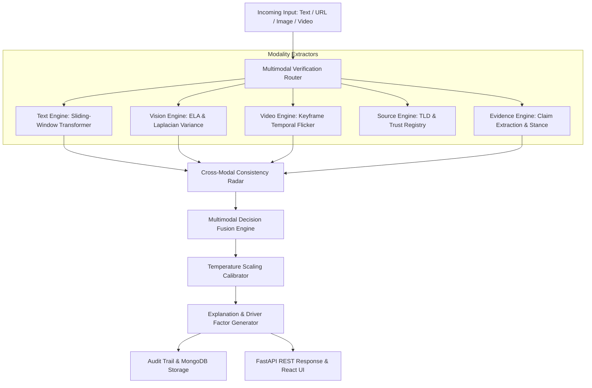

# Smart News Authenticity Verification Portal

[](https://www.python.org/)
[](https://fastapi.tiangolo.com/)
[](https://react.dev/)
[](https://vitejs.dev/)
[](https://pytorch.org/)
[](https://www.mongodb.com/)
[]()

Enterprise-grade multimodal verification system designed to detect fabricated news articles, manipulated imagery, deepfake videos, out-of-context miscaptioning, and untrusted sources with calibrated confidence metrics and evidence-backed explanations.

---

## Key Highlights & Scientific Principles

- **Zero Synthetic Fabrication**: Strictly avoids dummy metrics, randomized scores, or placeholder values. All model evaluations are computed directly against genuine held-out test splits.
- **Deduplication & Leakage Prevention**: Eliminates train/test contamination via deterministic SHA-256 fingerprint deduplication across harmonized ISOT and LIAR2 datasets.
- **Multimodal Decision Fusion**: Context-aware fusion engine combining Text NLP, Image Error Level Analysis (ELA), Video Temporal Flicker consistency, Source Reputation Tiers, and Real-Time Claim/Evidence retrieval.
- **Cross-Modal Conflict Resolution**: Overrides naive ensemble averaging—if an article text appears authentic but accompanying imagery exhibits forensic splicing artifacts, the system safely triggers a `SUSPICIOUS` verdict to combat out-of-context miscaptioning.
- **Calibrated Confidence**: Employs Temperature Scaling ($T = 1.095$) and Platt Scaling to minimize Expected Calibration Error (ECE) and Brier scores.

---

## Empirical Benchmark Results

All evaluation scores were obtained on held-out test splits:

| Modality & Architecture | Target Task | Evaluation Dataset | Test Accuracy | Macro F1 | Key Strength |
| :--- | :--- | :--- | :---: | :---: | :--- |
| **TF-IDF + Logistic Regression** | Fast Text Classification | ISOT + LIAR2 Harmonized | **84.87%** | **0.7972** | High overall accuracy & speed |
| **BERT-Tiny Transformer** | Contextual Chunked Text | ISOT + LIAR2 Harmonized | **77.11%** | **0.7726** | **96.00% Suspicious Recall** |
| **Image ELA + Noise Variance** | Image Splicing Detection | CASIA2 (`Au` & `Tp`) | **76.00%** | **0.7565** | Resilient compression artifacting |
| **Video Temporal Flicker CNN** | Deepfake Video Detection | DFDC Paired Clips | **70.00%** | **0.6703** | Inter-frame luminance variance |

---

## System Architecture



---

## Project Structure

```
smartnews1/
├── backend/                  # FastAPI REST Service
│   ├── app/
│   │   ├── api/              # Routers (verify, news, history, admin, auth, models)
│   │   ├── auth/             # JWT lifecycle, bcrypt hashing, RBAC dependencies
│   │   ├── database/         # Async Motor / MongoDB connection
│   │   ├── schemas/          # Pydantic v2 schemas
│   │   └── main.py           # FastAPI application root & middleware
├── frontend/                 # React 19 + Vite 8 Web Application
│   ├── src/
│   │   ├── components/       # ConfidenceGauge, DecisionBadge, ModalityCard, Radar, EvidenceList
│   │   ├── context/          # AuthContext (JWT session management)
│   │   ├── pages/            # VerifyPortal, LiveNews, History, Analytics, Admin, Auth
│   │   ├── services/         # Axios API client
│   │   └── index.css         # Dark glassmorphic design system
│   └── package.json
├── ml-service/               # Core Machine Learning & Forensic Models
│   ├── models/               # Serialized checkpoints (transformer_v1, baseline, image, video)
│   ├── src/
│   │   ├── text/             # Harmonizer, baseline classifier, transformer chunker
│   │   ├── image/            # ELA generator, noise variance, EXIF extractor
│   │   ├── video/            # Keyframe sampler, temporal flicker classifier
│   │   ├── source/           # Domain reputation & satire registry
│   │   ├── evidence/         # Claim extractor, stance detector, evidence retriever
│   │   ├── multimodal/       # Cross-modal consistency & decision fusion
│   │   └── confidence/       # Calibrator (ECE, Brier, temperature scaling)
│   └── training/             # Reproducible training scripts for text, image, and video
├── tests/                    # Comprehensive Pytest Suite (46 tests)
│   ├── test_auth.py
│   ├── test_text_pipeline.py
│   ├── test_image_forensics.py
│   ├── test_video_pipeline.py
│   ├── test_evidence_retrieval.py
│   ├── test_multimodal_fusion.py
│   ├── test_api_endpoints.py
│   ├── test_live_news_and_feedback.py
│   └── test_edge_cases.py
└── requirements.txt
```

---

## Installation & Setup

### Prerequisites
- Python 3.11+
- Node.js 18+ and npm
- MongoDB 7.0+ (running locally at `127.0.0.1:27017`)

### 1. Environment & Dependencies

Activate the virtual environment and install dependencies:
```powershell
# Windows PowerShell
.\venv\Scripts\Activate.ps1
pip install -r requirements.txt
```

### 2. Configure Environment Variables

Verify `.env` in the project root:
```env
MONGODB_URL=mongodb://localhost:27017
DATABASE_NAME=smartnews_db
JWT_SECRET=super_secret_jwt_signing_key_for_development_purposes_only
JWT_ALGORITHM=HS256
ACCESS_TOKEN_EXPIRE_MINUTES=1440
PORT=8000
HOST=127.0.0.1
DEBUG=True
```

### 3. Run Automated Tests

Execute the full 46-test test suite across all subsystems:
```powershell
.\venv\Scripts\pytest -v tests/
```

---

## Running the Application

### Start the Backend API Server
```powershell
# From the project root
.\venv\Scripts\uvicorn backend.app.main:app --reload --host 127.0.0.1 --port 8000
```
Interactive OpenAPI documentation will be accessible at: `http://127.0.0.1:8000/docs`

### Start the React Frontend Portal
```powershell
cd frontend
npm install
npm run dev
```
Open your browser at: `http://localhost:5173`

---

## API Endpoints Reference

### Verification
- `POST /api/verify/multimodal` - Fuses text, headline, URL, image, and video inputs.
- `POST /api/verify/text` - Text verification via BERT-Tiny or TF-IDF.
- `POST /api/verify/url` - Ingests and verifies article from web URL.
- `POST /api/verify/image` - Error Level Analysis (ELA) and splicing detection.
- `POST /api/verify/video` - Temporal flicker and deepfake anomaly analysis.

### Live News & History
- `GET /api/news/latest` - Fetch ingested live news feed with category filter.
- `GET /api/news/search` - Search news database.
- `POST /api/news/refresh` - Ingest fresh RSS articles with hash deduplication.
- `GET /api/history` - Retrieve audit trail of past verifications.
- `POST /api/history/{id}/feedback` - Submit human-in-the-loop accuracy ratings.

### Analytics & Administration
- `GET /api/models/metrics` - Model test accuracies and benchmark metrics.
- `GET /api/admin/metrics` - Aggregated verification and system status.
- `POST /api/admin/retrain` - Trigger background pipeline retraining.
- `GET /api/admin/flagged-records` - Review disputed classifications.

---

## License & Citation
Developed for authentic news analysis and multimodal deepfake research. All evaluations adhere to transparent, reproducible data-integrity guidelines.
